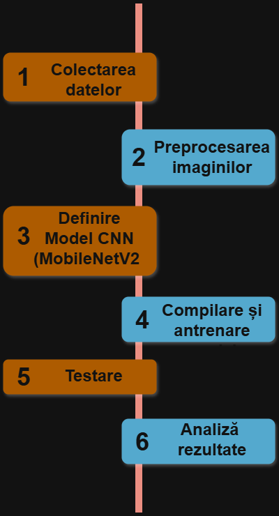

# Clasificare AMD (Degenerescența maculară legată de vârstă)

## Articole

| Nr. | Autor(i) / An | Titlul articolului / proiectului | Aplicație / Domeniu | Tehnologii utilizate | Metodologie / Abordare | Rezultate | Limitări | Comentarii suplimentare |
|-----|---------------|---------------------------------|--------------------|--------------------|----------------------|-----------|----------|------------------------|
| 1   | Saman Sotoudeh-Paima, Ata Jodeiri, Fedra Hajizadeh, Hamid Soltanian-Zadeh, 2022  |Multi-Scale Convolutional Neural Network for Automated AMD Classification using Retinal OCT Images|	Image and Video Processing, AMD Classification| Preprocesare; clasificare CNN; dataset NEH și UCS; rețea piramidală de caracteristici FPN; heatmaps |Identificare AMD uscat și umed, adică DRUSEN și neovascularizație coroidiană (CNV)|93.4%+-1.4%|Model performant, dar necesită validare pe seturi mai diverse|Cel mai apropiat de proiectul meu; https://arxiv.org/abs/2110.03002|
| 2   | Aaron Chang, Alex Lo, Anusha Saha, Vivan Shah, Viswajith Rajagopalan, Aditya Rathod, 2020  |Convolutional Neural Network to Classify Retinal OCT Images|Classify Retinal OCT Images, CNN| Clasificare CNN; Keras; Dataset din instituții medicale;  Comparare cu alte modele; |Clasificare imagini în CNV, DME, DRUSEN, NORMAL| 93,75%; Testat de mine pe 91.140 imagini- 90,18%| Lipsesc unele detalii din construirea modelului| Am putut testa modelul pentru ca este public; https://github.com/ACM-Research/image-classification-cnn/tree/master?tab=readme-ov-file|
| 3   | Botond Fazekas, Guilherme Aresta, Philipp Seeböck, Julia Mai, Ursula Schmidt-Erfurth, Hrvoje Bogunović 2025| SD-RetinaNet: Topologically Constrained Semi-Supervised Retinal Lesion and Layer Segmentation in OCT| 	Computer Vision and Pattern Recognition| CNN, învăţare semi‑supravegheată, segmentare, constrângeri topologice | Segmentarea automată a leziunilor retiniene și a straturilor retinei din imaginile OCT | Înbunătățirea rezultatelor| Nu sunt publice niște rezultate precise | Ajută la segmentare; https://arxiv.org/abs/2509.20864| 
| 4   | Robbie Holland, Thomas R. P. Taylor, Christopher Holmes, Sophie Riedl, Julia Mai,..., 2025| Specialized curricula for training vision-language models in retinal image analysis| 	Artificial Intelligence, Retinal image analysis| Encoder vizual: bazat pe ResNet‑50, pre‑antrenat prin învăţare contrastivă (BYOL) pe imagini OCT, Llama 3 de la Meta, Vision-language models| Un model vizual‑lingvistic specializat (VLM) numit RetinaVLM, capabil să interpreteze imagini OCT retiniene şi să genereze rapoarte textuale pentru managementul AMD| 63-67%| Nu există cod, rezultate decente| Interesantă ideea, https://arxiv.org/abs/2209.12468|
| 5   | M Elsharkawy, A Sharafeldeen, F Khalifa, A Soliman, A Elnakib, M Ghazal, A Sewelam, A Thanos, H S Sandhu, A El-Baz, 2024| A Clinically Explainable AI-Based Grading System for Age-Related Macular Degeneration Using Optical Coherence Tomography| Biomedical and health informatics, Foundation Model| Backbone pre‑antrenat, strategie de thresholding, segmentare| Dezvoltă un model de tip foundation model cu estimare a incertitudinii (FMUE) pentru diagnosticul bolilor retiniene din imagini Optical Coherence Tomography (OCT)| 95.74%, cu strategia de thresholding, performanţa a crescut la ~97.44%| Poate necesita validare suplimentară pe populaţii diversificate şi aparate OCT diferite| Fiabilitatea modelului depinde de calitatea imaginilor, https://ieeexplore.ieee.org/document/10402009|
| 6   | Reza Rasti, Member, IEEE; Armin Biglari; Mohammad Rezapourian; Ziyun Yang; and Sina Farsiu, Fellow, IEEE, 2023| RetiFluidNet: A Self-Adaptive and Multi-Attention Deep Convolutional Network for Retinal OCT Fluid Segmentation| Transactions on medical imaging, Medical image segmentation, fluid segmentation| CNN, scheme de multi‑scale deep self‑supervision learning (DSL), conexiuni skip multiple bazate pe atenţie| Scopul este de a detecta şi segmenta acumulările de lichid / fluide, care sunt semne importante în afecţiuni| Arhitectura RetiFluidNet oferă performanțe superioare, 93.6%| Modelul a fost testat pe un singur tip de aparat OCT| Complexitate ridicată a arhitecturii https://arxiv.org/abs/2209.12468|

## Schema și etapele proiectului

<table>
  <tr>
    <td>
      
    </td>
    <td>
      

   
      
<strong>1️. Colectarea datelor:</strong> Alegem un dataset popular cu cât mai multe imagini (ex. Kermany2018 și Srinivasan2014). Folosim un dataset cu imagini OCT în 3 foldere: train, val, test.​
   
      
<strong>2️. Preprocesarea imaginilor:</strong> Redimensionare, conversie RGB/grayscale, normalizare pixeli (0–1), eliminare zgomot și augmentare (rotații, flip, shift).
   
      
<strong>3️. Definire Model CNN (MobileNetV2):</strong> Definim modelul MobileNetV2 ca bază și adăugăm un strat final de clasificarea a celor 3 clase. Modelul este folosit ca extractor de caracteristici.​
   
      
<strong>4️. Compilare și antrenare model:</strong> Antrenăm modelul pe datele din train pentru 10 epoci. La sfârșitul fiecărei epoci se evaluează val și se raportează loss/accuracy pentru antrenare și validare.​
   
      
<strong>5️. Testare:</strong> Testăm modelul pe setul de date din test și pe încă un set de date + calcul acuratețe pe fiecare clasă.
   
      
<strong>6️. Analiză rezultate:</strong> Grafice Accuracy/Loss și obținem precizia, sensibilitatea, scorul F1 și matricea de confuzie​
   
    </td>
  </tr>
</table>

